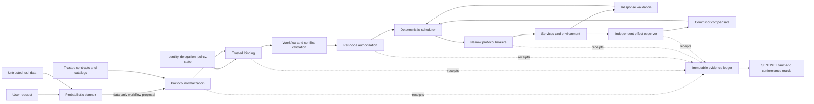

# SENTINEL deterministic workflow boundary

Status: research design; the current repository implements the single-action
trusted binder and evaluation harness, not this complete workflow runtime.

## Responsibility split

- **The probabilistic agent is a proposer.** It may emit a goal, select a
  registered capability, supply untrusted arguments, and propose dependencies.
- **Guardian is the reference deterministic boundary.** It binds trusted facts,
  validates the workflow, authorizes nodes, schedules eligible work, delegates
  execution to narrow brokers, validates responses, and controls compensation.
- **SENTINEL is the assurance layer.** It injects faults across that boundary
  and determines from independent effects whether the boundary held.



The model never receives service credentials. The scheduler cannot create new
capabilities. A broker can invoke only the operation in an authorized,
digest-bound node. A response is data, not an instruction.

## Canonical workflow representation

The existing `AgentProposal` and `CanonicalAction` remain the atomic unit. A
new `WorkflowProposal` should be an acyclic graph of authority-free nodes:

```json
{
  "workflow_id": "agent-generated correlation only",
  "nodes": [
    {
      "node_id": "inventory",
      "capability_name": "inventory.lookup",
      "arguments": {"sku": {"literal": "A-17"}},
      "depends_on": [],
      "join": "all"
    },
    {
      "node_id": "price",
      "capability_name": "pricing.quote",
      "arguments": {"sku": {"literal": "A-17"}},
      "depends_on": [],
      "join": "all"
    },
    {
      "node_id": "reserve",
      "capability_name": "inventory.reserve",
      "arguments": {
        "sku": {"from": "inventory.output.sku"},
        "quote_id": {"from": "price.output.quote_id"}
      },
      "depends_on": ["inventory", "price"],
      "join": "all"
    }
  ]
}
```

The trusted compiler resolves each node into a `CanonicalAction` and adds facts
the agent cannot assert:

- authenticated principal, tenant, agent, session, and delegation chain;
- contract and adapter identity plus content digest;
- canonical operation, destination, resource, and effect domains;
- request and response schemas;
- read/write sets, commutativity class, reversibility, and risk tier;
- idempotency strategy, retry ceiling, deadline, and concurrency ceiling;
- required predecessors, trusted data mappings, and join semantics;
- precondition, commit-time authorization, postcondition, and compensation;
- policy version and current trusted state version.

## Deterministic scheduling rules

Two ready nodes may run concurrently only when all of these are true:

1. neither consumes output from the other;
2. their trusted read/write and effect sets do not conflict, or the catalog
   declares the specific effects commutative;
3. their authorization obligations do not establish an order;
4. neither is a compensation or approval barrier;
5. concurrency and rate limits permit both; and
6. the protocol adapter can preserve the required correlation and idempotency
   semantics.

Otherwise the scheduler uses a stable topological order. The agent's
`depends_on` edges may make execution more restrictive but cannot remove
trusted catalog or policy dependencies. Cycles, unknown nodes, ambiguous field
mappings, and undeclared dynamic expansion fail closed.

For each node the state machine is:

```text
PROPOSED -> NORMALIZED -> BOUND -> AUTHORIZED -> DISPATCHED
          -> RESPONSE_VALIDATED -> EFFECT_OBSERVED -> COMMITTED
                                             \-> COMPENSATING -> COMPENSATED
Any pre-dispatch failure -> BLOCKED
Any ambiguous post-dispatch state -> QUARANTINED_PENDING_RECONCILIATION
```

No post-dispatch timeout is represented as a clean denial: the effect is
unknown until reconciliation proves otherwise.

## Protocol adapter boundary

Adapters translate wire contracts; they do not make authorization decisions.
Every adapter must produce the same canonical fields and receipts.

| Adapter | Trusted source | Invocation identity | Response validation | Protocol-specific hazards |
|---|---|---|---|---|
| REST | Pinned OpenAPI description plus deployment catalog | server, method, normalized path, operation reference, media type | status/header/body schema plus postcondition | alternate servers, path normalization, redirects, callbacks, content negotiation |
| SOAP | Pinned WSDL/XSD, binding, endpoint, and WS-Security policy | service/port/operation QName and SOAP action | signed envelope, declared output or fault, XSD, postcondition | XML signature wrapping, namespace confusion, timestamp/replay, endpoint override |
| GraphQL | Pinned schema and persisted-operation registry | endpoint, operation hash/name, operation type, variables | GraphQL response shape, errors, extensions policy, postcondition | aliases, fragments, query cost, introspection drift, batched operations, mutation ordering |
| gRPC | Pinned protobuf descriptor set and service catalog | authority, fully qualified service/method, RPC cardinality | decoded message descriptor, status and trailers, postcondition | streaming cardinality, deadlines, metadata spoofing, partial streams |
| AsyncAPI | Pinned document, bindings, broker and schema registry | channel, send/receive action, message schema, correlation and partition | acknowledgement plus independently consumed/observed effect | duplicate delivery, reordering, consumer lag, poison messages, partition changes |
| MCP/A2A | Pinned gateway registry mapped to one of the above or a narrow broker | authenticated server/agent and registered capability | declared result schema followed by effect observation | tool-description injection, confused deputy, server substitution, nested delegation |

“Protocol neutral” does not mean ignoring protocol semantics. It means each
adapter must prove how protocol-specific identity and delivery facts map into a
common action/effect contract.

## Request and response handling

Every external input remains data with an integrity and confidentiality label.
Natural-language descriptions, service errors, GraphQL strings, XML content,
event payloads, and tool results cannot add nodes, change dependencies, expand
authority, select credentials, or define success.

Before dispatch, Guardian checks:

1. proposal schema and size limits;
2. trusted contract lookup and digest;
3. argument validation and canonicalization;
4. authenticated identity, tenant, delegation, destination, and resource;
5. workflow dependencies, conflicts, budgets, and temporal obligations;
6. policy authorization using trusted current state; and
7. a broker-specific, single-use execution envelope.

After dispatch, Guardian checks:

1. response correlation and broker receipt;
2. status, headers/metadata, and response schema;
3. output-field mapping and provenance labels;
4. independently observed effect and bounded postcondition;
5. retry, reconciliation, compensation, or escalation policy; and
6. an immutable terminal record before dependent nodes become eligible.

## SENTINEL fault surface

The current six-layer model should expand into a workflow boundary model:

1. input and provenance;
2. probabilistic proposal;
3. protocol contract and adapter;
4. trusted binding and catalog;
5. workflow graph, dependency, and conflict analysis;
6. authorization and obligations;
7. scheduler, retry, and idempotency state;
8. broker and wire delivery;
9. service/environment effect;
10. response validation and independent observation;
11. compensation and terminal recording.

Single faults test local fail-closed behavior. Pairwise and guided higher-order
faults test assumption interactions, such as stale contract plus endpoint
substitution, false independence plus retry duplication, or valid response
schema plus false postcondition observation.

## Required implementation slices

1. Define and test `WorkflowProposal`, `CanonicalWorkflow`, node lifecycle, and
   conflict-set schemas without any live service.
2. Add a deterministic scheduler with fan-out/fan-in, stable serialization,
   bounded retry, ambiguous-effect quarantine, and compensation.
3. Implement OpenAPI and gRPC adapters first because the selected public
   microservice subjects already expose HTTP/gRPC surfaces.
4. Add GraphQL and SOAP conformance fixtures; keep them out of the main
   external-validity claim until exercised on maintained public systems.
5. Add AsyncAPI/Kafka only after correlation, duplicate-delivery, and effect
   observation semantics are explicit.
6. Integrate one durable-workflow backend, preferably Temporal, as an execution
   substrate baseline. Guardian must remain the security authority; the engine
   supplies durability, not authorization.
7. Extend SENTINEL with protocol-equivalence, schedule-invariance,
   conflict-serialization, dependency-authenticity, and complete-mediation
   oracles.

## Non-claims

- The boundary does not make an incorrect policy correct.
- Schema validation does not establish semantic authorization.
- A deterministic scheduler does not make distributed effects exactly once.
- A valid tool response does not prove a real-world effect.
- Protocol adapters do not erase transport-specific attack surfaces.
- Passing a finite fault campaign is not a proof of universal safety.
