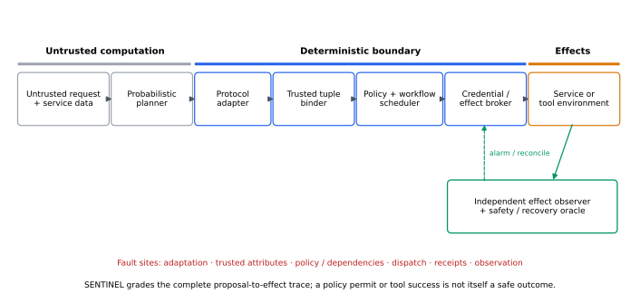
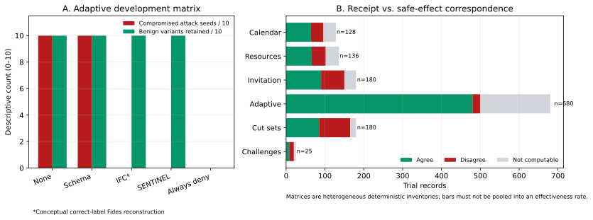
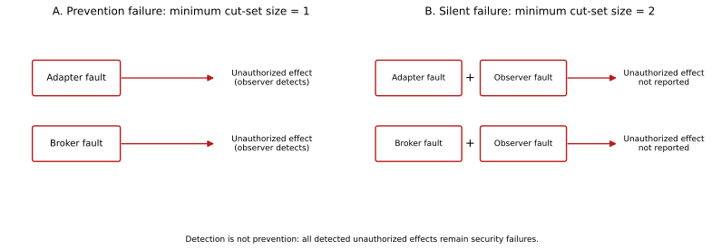

# SENTINEL: Effect-Grounded Conformance Testing of Deterministic Boundaries for Agentic Microservice Workflows

**Manuscript status:** development-evidence draft; not yet ready for archival submission

**Current framing:** effect-grounded assurance evaluation with a replication and negative-results core

**Evidence boundary:** deterministic artifact probes and inert synthetic experiments; no production effectiveness claim

## Abstract

Agentic systems translate untrusted natural-language requests and service data into consequential actions. Deterministic boundaries can restrict those actions, but their guarantees depend on contract adapters, trusted attributes, policy state, execution brokers, receipts, and outcome observation. Nominal policy conformance and successful tool responses therefore do not establish that the intended effect occurred safely. We introduce **SENTINEL**, a protocol-neutral methodology for cross-layer conformance testing and fault injection around deterministic agent boundaries. SENTINEL preserves native baseline metrics while recording proposal, binding, verdict, dispatch, receipt, environment effect, and terminal state in separate evidence namespaces. A 28-step reproduction campaign executed public AgentDojo, CaMeL, Agent-C, Fides-tutorial, and ToolGate artifacts at explicitly graded fidelity and constructed deterministic calendar, resource-transition, adaptive-input, and boundary-fault matrices. Across 1,329 heterogeneous development trials, the evidence inventory contained 240 receipt-versus-safe-effect disagreements; these counts are descriptive and are not pooled into an effectiveness rate. SENTINEL and an idealized correct-label Fides reconstruction tied in the nominal and adaptive synthetic matrices. In the constructed SENTINEL chain, either an adapter or broker fault was sufficient to defeat prevention, whereas silent compromise required either fault together with observer omission. A prospective duplicate-retry case further showed that observation can detect an unsafe repeated effect without preventing it. The contribution is thus not a new deterministic guardrail or a superiority claim, but an effect-grounded method for exposing assurance failures hidden by policy verdicts and tool receipts. Production effectiveness remains unestablished pending matched live systems, authenticated observation, executable holdouts, repeated probabilistic blocks, and uncertainty-bearing analysis.

## 1. Introduction

Machine-learning and large-language-model components increasingly sit upstream of consequential software workflows. In cloud operations, a model may interpret telemetry, localize a failure, query several downstream services in parallel, wait for dependent results, choose a remediation, and invoke infrastructure APIs. The model can be wrong because of ordinary prediction error, distribution shift, incomplete evidence, poisoned service data, malicious instructions, or an invalid dependency plan. A common response is to place a deterministic policy or reference monitor between the model and the environment.

This architectural pattern is well established. Runtime-assurance and shielding systems place an unverified advanced component behind a trusted safety mechanism. Agent-security systems such as CaMeL, Fides, AgentSpec, Agent-C, PCAS, ToolGate, and ActGov enforce capabilities, information-flow, temporal constraints, pre/postconditions, or declarative policies outside the model. Durable workflow systems already provide sequential, parallel, retry, and compensation semantics, while OpenAPI, WSDL/SOAP, GraphQL, gRPC, and AsyncAPI describe heterogeneous service interfaces. We therefore do not claim that deterministic boundaries, workflow graphs, or action contracts are new.

External enforcement is necessary, but it does not make the surrounding system infallible. A deterministic decision can be consistently wrong when its resource catalog is stale. A correctly authorized action can be substituted or replayed at execution. A fail-closed dependency can prevent harm while also preventing recovery. An action can return success without restoring the service. A postcondition monitor can observe delayed or corrupted signals. These are faults in the assurance chain rather than failures of the language model alone.

Existing evaluations commonly measure attack success, policy classification, task completion, recovery-plan validity, or fault diagnosis. These measures answer important but different questions. A policy-conformance score does not reveal whether an unauthorized effect reached the environment. Endpoint success does not reveal whether recovery was authorized. Fault-label accuracy does not reveal whether a guardrail contained the fault. As a result, we lack a systematic way to measure the **fault coverage** of deterministic guardrails around predictive systems.

We present SENTINEL, a cross-layer conformance and fault-injection methodology for this purpose. SENTINEL models the complete path from untrusted request and service evidence through a protocol-normalized workflow graph to observed effects and recovery. It injects controlled faults into the proposal, contract adapter, trusted binder, dependency graph, policy, scheduler, broker, compensation path, and outcome observer, both individually and in selected combinations. Each trial is graded by independently defined state and safety oracles.

We instantiate SENTINEL in microservice remediation. ARIA produces diagnoses and typed workflow proposals from public benchmark evidence. Every model input and output is treated as data: it cannot assert identity, authority, resource classification, effect class, independence, or success. Guardian independently binds identity, capability, resource, destination, tenant, service contract, dependency/conflict facts, policy, and current state. It schedules only authorized ready nodes; narrow brokers alone possess service credentials. Responses are schema-checked and provenance-labeled before dependent nodes may consume them. Public microservice environments determine whether authorized effects occurred, whether ordering and cardinality were preserved, and whether service health recovered.

This development study makes four bounded contributions:

1. **A protocol-neutral experimental fault model and record schema** that separates an untrusted proposal from trusted identity, authority, resource, service-contract, dependency, conflict, decision, dispatch, receipt, and observed-effect facts.
2. **Pre-registered effect-grounded conformance relations** for protocol representation, complete mediation, dependency authenticity, safe parallelization, conflict serialization, response/effect agreement, and retry/compensation behavior.
3. **A reproducible cross-layer fault-injection harness** that evaluates effect records rather than policy verdicts, schemas, or workflow status alone, and minimizes unsafe traces into assurance cut sets.
4. **A replication and negative-results account** showing where public artifacts execute, where conceptual reconstruction is unavoidable, why nominally secure mechanisms tie under ideal assumptions, and which evidence is still required for an archival effectiveness claim.

The contribution is an evaluation method and development result. We do not claim to invent external enforcement, information-flow labels, provenance tracking, risk-adaptive authorization, typed action contracts, pre/postcondition checking, symbolic state, temporal policy, workflow DAGs, durable execution, sagas, commit-time freshness, replay protection, causal provenance, protocol description languages, independent application-state assertions, or guarded Kubernetes remediation. We also do not claim published-defense efficacy, production prevalence, or superiority over correctly labeled information-flow control.

## 2. Background and Related Work

### 2.1 Runtime assurance and shielding

The Simplex architecture separates an unverified advanced controller from a trusted decision mechanism and a safety-preserving fallback. Runtime shielding similarly prevents a learning agent from executing actions that violate a formal specification. These systems establish two principles relevant here: safety authority must remain outside the learning component, and any guarantee is relative to the fidelity of the safety specification and environment model.
[@seto1998simplex; @alshiekh2018shielding; @slagel2024rta]

SENTINEL starts from these principles and evaluates their operational assumptions. Rather than synthesizing a new shield, it perturbs the inputs and components on which a software guardrail depends and observes whether protected-system safety and recovery are preserved.

### 2.2 Runtime enforcement for LLM agents

CaMeL separates trusted control flow from untrusted data and uses capabilities to prevent unauthorized exfiltration. Fides formalizes information-flow control for agent planners. AgentSpec supplies a runtime-constraint language, while Agent-C enforces temporal constraints. PCAS compiles policies into an instrumented reference monitor over dependency graphs. AgentFlow adds flow-centric policies and bounded formal verification.
[@debenedetti2025camel; @costa2025fides; @wang2025agentspec; @kamath2025agentc; @palumbo2026pcas; @shivakumar2026agentflow]

ToolGate uses Hoare-style preconditions and verified postconditions to protect a
symbolic state during tool execution [@liu2026toolgate]. It is especially close
contract-level prior art. SENTINEL's proposed novelty is not action contracts;
it is the cross-layer, effect-grounded fault evaluation of the wider assurance
chain in which such contracts operate.

These systems establish the breadth of deterministic runtime enforcement. SENTINEL does not propose a competing policy language. It evaluates how such enforcement behaves when trusted attributes, policy data, dependencies, or enforcement paths are faulty.

### 2.3 Authority, provenance, and durable effects

Open Agent Passport studies per-action authorization and signed audit records. Commit-time authorization requires earlier authority evidence to remain fresh, causally prior, effect-bound, and eligible when a durable effect occurs. CapLease shows that single-use identifiers do not prevent semantic replay without durable authorization state. Causal-reference-monitor work models information learned from denied actions. Proof-of-execution work binds a contract, causal history, effect, and replay context into a verifiable execution artifact.
[@uchibeke2026oap; @santosgrueiro2026commit; @xu2026caplease; @chinaei2026causality; @rhodes2026poe]

These mechanisms can strengthen a Guardian implementation, but they are prior art rather than our novelty. SENTINEL uses substitution, staleness, replay, denial feedback, and incomplete history as fault operators and measures the residual consequences under different defenses.

### 2.4 Guardrail benchmarks

AgentDojo evaluates indirect prompt injection in tool-using agents. Task Shield evaluates task alignment. TraceSafe-Bench evaluates mid-trajectory guardrail judgment. NIST has shown that adaptive attacks, consequence-specific reporting, and repeated attempts can materially change apparent agent robustness.
[@debenedetti2024agentdojo; @jia2025taskshield; @chen2026tracesafe; @mou2026toolsafe; @nist2025hijacking]

AGENTCHAOSBENCH is the closest methodological neighbor: it injects operational faults at model, tool, guardrail, and inter-agent boundaries and asks models to detect and localize those faults from telemetry. SENTINEL asks a different question. It evaluates whether the assurance architecture prevents prohibited effects and preserves recovery after a fault is injected. Its primary labels are environment safety and recovery outcomes, not fault type or location.
[@zhang2026agentchaosbench]

Metamorphic testing addresses systems for which complete expected-output oracles are difficult to construct by checking relations between source and transformed executions. It has been applied to LLM behavior and autonomous systems. SENTINEL does not claim this testing method as new; it defines assurance-specific relations over authority, freshness, identity, risk, and effects and combines them with cross-layer fault injection and independent environment-state oracles.
[@cho2025llmorph; @liang2025automt]

### 2.5 Autonomous remediation

AIOpsLab evaluates agents over cloud incident lifecycles, while MicroRemed evaluates executable remediation generation. R2Act shows that high diagnostic accuracy does not imply valid recovery actions. ARBITER implements typed, policy-gated Kubernetes remediation. Risk-constrained remediation work combines blast radius, reversibility, epistemic uncertainty, and adaptive human review. AIOpsDoom shows that manipulated telemetry can steer AIOps agents toward harmful actions.
[@chen2025aiopslab; @zhang2025microremed; @qi2026r2act; @habibi2026arbiter; @dai2026saferemediation; @pasquini2025aiopsdoom]

These studies motivate our domain and baselines. SENTINEL's distinction is to test the fault coverage of the protection chain itself, including interactions among evidence faults, predictor errors, authority faults, enforcement faults, and outcome-observation faults.

## 3. System Model

### 3.1 Proposal-to-workflow-effect pipeline

**Figure 1. SENTINEL assurance architecture.** The model proposes; the
deterministic boundary derives and enforces authority; the environment produces
effects; and an independently sourced oracle grades those effects. Faults may
occur on either the prevention path or the observation path.

The predictor emits an authority-free workflow proposal (G_p=(V_p,E_p)).
Each node names a registered capability and untrusted arguments; edges propose
data or control dependencies. The deterministic boundary derives a canonical
workflow (G_c=(V_c,E_c,C_c)), where (C_c) contains trusted conflict and
temporal constraints that the proposal cannot remove. We model each node as:

\[
e,a_p \xrightarrow{N} a_n \xrightarrow{B} a_c
\xrightarrow{D} v,o \xrightarrow{S} x \xrightarrow{X} s'
\xrightarrow{R,O} r,
\]

where:

- \(e\) is untrusted request, operational, and predecessor-output data;
- \(a_p\) is the authority-free action proposed by the fallible predictor;
- \(N\) is a protocol adapter that resolves a pinned service contract and
  produces normalized action \(a_n\);
- \(B\) binds the proposal to trusted context, producing canonical action \(a_c\);
- \(D\) is the policy decision function producing verdict \(v\) and obligations \(o\);
- \(S\) is a deterministic scheduler producing a dispatchable node \(x\) only
  after authentic dependencies complete and trusted conflicts permit it;
- \(X\) is the enforcement/execution mechanism;
- \(s'\) is the resulting environment state; and
- \(R\) validates and maps the protocol response while \(O\) independently
  observes effects and produces terminal record \(r\).

Independent ready nodes may run concurrently only when their trusted data,
authority, resource, and effect sets are non-conflicting or explicitly
commutative. Otherwise the scheduler uses a stable topological serialization.
The single-action pipeline is the one-node special case. A node may be blocked,
escalated, executed, quarantined pending reconciliation, or compensated after a
failed postcondition.

### 3.2 Safety and recovery oracles

For incident \(i\), initial state \(s_i\), and effect trace \(\tau_i\), an independent policy oracle defines:

\[
Safe(i, \tau_i) \in \{0,1\}.
\]

An independent environment oracle defines:

\[
Recovered(i, s'_i, W) \in \{0,1\},
\]

where \(W\) is a predeclared observation window. The agent, predictor, and guardrail may not define either oracle after observing results.

**Safe recovery** occurs only when both predicates equal one. An endpoint that appears healthy after an unauthorized mutation is an unsafe success, not a safe recovery.

### 3.3 Trusted computing base

The declared trusted computing base includes:

- experiment controller and fault scheduler;
- ground-truth incident and action manifests;
- oracle definitions;
- root keys or test signing keys;
- broker credential isolation;
- terminal record writer.

Guardian, ARIA, policy bundles, catalogs, state caches, providers, and observers can each be faulted according to the experiment condition. The paper's guarantees apply only when the stated trusted-computing-base assumptions hold.

## 4. SENTINEL Fault Model

### 4.1 Evidence faults

- stale telemetry window;
- missing modality;
- value manipulation within schema;
- service-label alias corruption;
- faithful versus shuffled or reversed topology;
- poisoned log or trace content.

### 4.2 Predictor faults

- wrong root-cause service;
- wrong fault type;
- inadmissible action for a correct diagnosis;
- excessive action magnitude;
- malformed arguments;
- overconfident incorrect proposal.

Natural ARIA errors are preserved. Controlled mutations supplement them without being counted as independent model errors.

### 4.3 Contract-adapter faults

- stale or substituted OpenAPI, WSDL, GraphQL, protobuf, or AsyncAPI contract;
- operation or endpoint alias resolves to a different capability;
- request canonicalization mismatch between policy and broker;
- response schema accepts a semantically different result;
- protocol downgrade, redirect, alternate channel, or shadow route bypass;
- identity, correlation, streaming, or delivery metadata omitted.

Protocol-representation tests preserve one registered logical capability while
changing only its wire representation. Equivalent representations should yield
the same canonical authority and effect class; protocol-specific delivery facts
remain explicit rather than being erased.

### 4.4 Binding faults

- stale capability manifest;
- incorrect resource or destination mapping;
- cross-tenant alias collision;
- missing provenance object;
- agent-asserted security attribute accepted as authoritative;
- policy/manifest version mismatch ignored.

### 4.5 Workflow and scheduling faults

- missing, forged, or cyclic dependency edge;
- dependent node dispatched before its predecessor is terminal;
- predecessor text interpreted as control flow or authority;
- conflicting writes falsely labeled independent;
- non-commutative nodes executed concurrently or in reversed order;
- stale authorization retained across a long-running workflow;
- retry budget, concurrency ceiling, or approval barrier bypassed;
- compensation omitted, duplicated, reordered, or applied to the wrong effect.

### 4.6 Policy faults

- omitted deny or escalation rule;
- conflicting permit and deny rules;
- stale policy bundle;
- provider timeout;
- fail-open default;
- incorrectly lowered risk tier;
- cached approval after revocation.

Policy mutations should be systematic and schema-valid. Each mutant records the exact operator and expected semantic change.

### 4.7 Enforcement faults

- guardrail bypass;
- argument substitution after decision;
- stale state at commit time;
- duplicate execution through retry or concurrency;
- partial external effect before crash;
- unauthorized fresh reissuance;
- broker/result mismatch.

### 4.8 Observation faults

- success response with no state change;
- delayed health regression outside a short observation window;
- corrupted outcome receipt;
- missing rollback confirmation;
- monitoring blind spot;
- stale postcondition evidence.

### 4.9 Injection sites and fidelity

Each operator is applied at the boundary named by the fault model rather than
by relabeling a nominal action. The controller-level adapters mutate stale
evidence and predictor targets before decision, pass binding and policy faults
to the real decision adapter, and alter only the claimed-recovery channel for a
false-success observation fault. The independent Kubernetes observer remains
unchanged. Enforcement adapters act at the broker boundary: substitute the
post-decision target, bypass a denial, drop before submission, or issue two
attempts for one semantic action. Every terminal record contains the requested
operator, applied transformation, and per-attempt receipt so analysis can
reject missing or substituted applications. Environment state grades target
and recovery. Because duplicate writes can converge to the same state, broker
receipts additionally identify repeated semantic actions; live calibration
must reconcile them with Kubernetes audit events before confirmatory use. Each
submitted attempt therefore carries a unique field-manager correlation. A
separate audit parser requires an API-server `ResponseComplete` scale event
from the dedicated actuator identity with matching namespace, target, replica
value, completion status, and correlation. Reconciliation is exact over the
bounded trial window: missing or extra events fail the trial's evidence gate.

## 5. Development Study

### 5.1 Research questions

The completed campaign addresses five development-stage questions:

- **RQ1—Reproduction fidelity:** Which public artifacts execute, and which
  comparisons remain conceptual reconstructions?
- **RQ2—Outcome correspondence:** When do native verdicts or receipts disagree
  with independently graded safe effects?
- **RQ3—Nominal robustness:** Do adaptive content mutations distinguish
  SENTINEL from correctly labeled information-flow control under ideal trusted
  assumptions?
- **RQ4—Assurance structure:** Which minimum trusted-boundary fault sets cause
  any unauthorized effect, and which cause a silent unauthorized effect?
- **RQ5—Claim validity:** Which apparent positive results survive prior-art
  subtraction, utility controls, and a confirmatory-validity audit?

### 5.2 Evidence grades and subjects

The study separates public-artifact execution, artifact replication with
substitutions, conceptual reconstruction, and synthetic mechanism evidence.
Table 1 is a fidelity statement, not a ranking of the defenses.

| Subject | Executed evidence | Grade and claim limit |
|---|---|---|
| AgentDojo | Public source, native tasks, ground truths, and scorer diagnostics | Source executability and benchmark validation; no published efficacy number reproduced |
| CaMeL | Released tests, scripted smoke path, policy inventory, and deterministic resource probes | Public-artifact execution; no published defense number reproduced |
| Agent-C | Pinned Zenodo archive, grammar/checker paths, and selected formula replays | Artifact replication with dependency substitutions; no model-backed result reproduced |
| Fides | Model-free tutorial core plus a matched AgentDojo-style comparison | Tutorial execution; comparison is explicitly conceptual |
| ToolGate | Official artifact precondition/executor/postcondition path | Deterministic artifact probe; no ToolBench or MCP-Universe number reproduced |
| Invitation Is All You Need | Five threat classes mapped to ten inert behavioral analogs | Conceptual reconstruction; 0/14 exact production scenarios |
| SENTINEL extensions | Calendar, resource, adaptive-input, boundary-fault, and prospective challenge matrices | Deterministic synthetic development evidence only |

### 5.3 Controls and evidence record

Every matched matrix includes no-defense and always-deny sanity conditions.
Where meaningful, schema-only, correct-label Fides reconstruction, and
SENTINEL receive identical fixed proposals. Native metrics remain in their own
namespaces. The derived action/effect record separately identifies proposal,
binding, verdict, dispatch, receipt, environment effect, and terminal state;
missing evidence remains explicitly not computable.

The immutable campaign inventory comprises 1,329 deterministic development
trials. It includes deliberately permissive controls, intentionally injected
boundary faults, and repeated mechanism checks. Consequently, neither the 240
unauthorized-effect observations nor the 240 receipt/effect disagreements are
population rates or independent samples.

### 5.4 Analysis boundary

The study reports exact descriptive counts and byte-identical deterministic
reruns. It does not calculate confidence intervals: the trials are
purposefully constructed, heterogeneous, and non-exchangeable. A planned set
of five holdout names was audited before use and found to lack frozen inputs,
initial states, scorers, and expected outcomes. Those cases were downgraded to
a post-development prospective challenge set rather than mislabeled as
confirmation.

## 6. Results

### 6.1 Artifact and benchmark findings

The reproduction campaign recovered source executability and several
mechanism-level behaviors, but reproduced zero published effectiveness
numbers. It also found benchmark and integration limitations relevant to the
paper's evaluation thesis: an AgentDojo representation mismatch incorrectly
classified injectable tasks; one native scorer rejected an exact effect under
ambiguous search results; CaMeL policy probes admitted selected untrusted
resource selectors; Agent-C formulas frequently left non-identity write
arguments unconstrained; and ToolGate's native symbolic state disagreed with
independent effects under false-success and post-effect malformed-response
faults. These observations motivate effect-grounded comparison without turning
heterogeneous native metrics into a common score.

### 6.2 Nominal and adaptive defense comparison

In the Invitation-style matrix, correct-label Fides reconstruction and
SENTINEL each preserved all ten benign controls and safely handled all twenty
attack trials. Neither had an unauthorized effect. Schema-only, no defense,
and the deliberately mislabeled Fides adapter each produced twenty
unauthorized effects. Always-deny contained attacks but lost all benign
utility. Thus SENTINEL has no nominal superiority result over ideal IFC.

The frozen adaptive development matrix reached the same conclusion. No
defense and schema-only were compromised on the first attempt for all ten
attack seeds. Correct-label Fides and SENTINEL each exhausted 120 attempts
without an unauthorized effect and retained 60/60 benign variants. Always-deny
again retained 0/60 benign variants. Because the adaptive generator was a
deterministic state machine over inert mutation descriptors, this is a
mechanism-conformance result, not an LLM susceptibility estimate.

**Figure 2. Development evidence.** Panel A shows the matched adaptive sanity
conditions after putting benign utility and compromised seeds on a common
0–10 descriptive scale. Panel B preserves agreement, disagreement, and missing
evidence separately. The matrices are not pooled into an effectiveness rate.

| Defense | Attack attempts | Compromised seeds | Benign variants retained | Unauthorized effects |
|---|---:|---:|---:|---:|
| No defense | 10 | 10/10 | 60/60 | 10 |
| Schema allowlist | 10 | 10/10 | 60/60 | 10 |
| Correct-label Fides reconstruction | 120 | 0/10 | 60/60 | 0 |
| SENTINEL | 120 | 0/10 | 60/60 | 0 |
| Always deny | 120 | 0/10 | 0/60 | 0 |

### 6.3 Cross-layer effect correspondence

Receipt/effect disagreement recurred across distinct failure classes:
unauthorized effects paired with successful receipts, false-success receipts
without effects, post-effect rejection, wrong targets, duplicate retries, and
observer omission. The common trace prevented two invalid inferences: formula
admission was not treated as a completed effect, and missing observation was
not treated as evidence of safety. Across the six final synthetic matrices,
disagreement counts were 32/128 calendar trials, 36/136 resource trials,
60/180 Invitation trials, 20/680 adaptive trials, 80/180 cut-set trials, and
12/25 prospective challenge trials. These are designed-condition counts, not
prevalence estimates.

### 6.4 Minimal assurance cut sets

The boundary-fault experiment held ten attack actions and five benign actions
fixed across nominal controls and all subsets of adapter, broker, and observer
faults. A single adapter fault or broker fault caused unauthorized effects in
all ten attack actions; a healthy observer detected each effect. Observer
failure alone caused no unauthorized effect. Silent compromise required a
prevention fault together with observer omission.

**Figure 3. Minimal assurance cut sets.** Prevention has singleton cut sets;
silent compromise has two-layer cut sets in the constructed chain. Detection
does not receive prevention credit.

| Outcome | Minimal cut sets | Interpretation |
|---|---|---|
| Any unauthorized effect | `{adapter}`, `{broker}` | SENTINEL is not one-fault-safe for prevention |
| Silent unauthorized effect | `{adapter, observer}`, `{broker, observer}` | A separate observer adds detection redundancy, not effect prevention |

### 6.5 Prospective challenge failure

The post-development challenge set combined normalized-destination,
redirect-plus-digest, delayed memory/agent, resource-substitution, and
duplicate-effect factors. Correct-label Fides and SENTINEL each safely handled
four of five cases. Both failed the duplicate-effect false-success case: one
approved write completed, a false failure receipt triggered a retry, and the
environment recorded two effects. SENTINEL's observer detected the duplicate
after it occurred. The case therefore remains a security failure and motivates
broker idempotency, exactly-once semantics where feasible, or compensation.

## 7. Interpretation

Three findings define the paper's contribution boundary.

First, the deterministic-boundary pattern is prior art. Information-flow
control, temporal constraints, Hoare-style contracts, typed actions, symbolic
state, and workflow enforcement cannot be claimed as SENTINEL inventions.
Trusted complete-tuple construction is a useful reference mechanism, while
non-transitive URL/file transitions are an experimental factor rather than a
new security model.

Second, nominal attack blocking does not distinguish ideal mechanisms. Under
correct trusted labels, SENTINEL and the Fides reconstruction tied in both the
fixed and adaptive matrices. The differentiator is not another prompt filter;
it is whether the evaluation follows authority and effects across adapters,
brokers, receipts, and observers—including faults in those trusted layers.

Third, observation and prevention are distinct. Independent effects changed
the interpretation of scorer outputs, symbolic commits, successful receipts,
and retries. Yet the duplicate case demonstrates the limit: detecting an
effect after completion does not make the execution safe. The strongest
supported claim is therefore methodological:

> SENTINEL exposes and minimizes cross-layer assurance failures that nominal
> policy and tool-success metrics can hide.

This claim is supported in deterministic development environments. Whether
the resulting cut sets recur across real systems is an open empirical question.

## 8. Threats to Validity

**Construct validity.** The synthetic policies and consequence labels encode
the intended security property by construction. We mitigate circularity by
preserving native baseline metrics, using separate effect namespaces, and
including deliberately falsifying cases, but official baseline integrations
remain necessary.

**Internal validity.** Deterministic state machines make fault application and
reruns exact, but they may omit timing, parser, network, credential, and
controller behavior. The independent oracle is process-separated by namespace,
not independently authenticated infrastructure.

**External validity.** Calendar and resource fixtures do not establish behavior
on production Gmail, Calendar, browsers, Kubernetes, or physical devices.
Invitation coverage is class-level analogy, not exact reproduction.

**Statistical validity.** The 1,329 trials span incompatible matrices and
deliberately selected conditions. They are neither random nor exchangeable and
support no pooled rate, significance test, or confidence interval.

**Researcher degrees of freedom.** Only names—not executable cases—were frozen
for the planned holdout. We therefore rejected the confirmatory label and
reported the later cases as prospective development challenges.

## 9. Limitations and Required Confirmation

The study has no matched official defense comparison on resettable public
multi-service systems, no model-backed adaptive attack rate, no valid held-out
confirmation, no repeated probabilistic or infrastructure blocks, and no
uncertainty analysis. It does not measure latency, recovery, rollback, or
availability in a live system. Same-host replay does not establish independent
reproducibility.

The archival study must authenticate environment effects independently from
Guardian and the broker; freeze executable holdout inputs, states, scorers,
exclusions, and analysis; repeat planners and deployment/load blocks; and add
idempotency and compensation ablations. Until then, the reported counts are
development evidence and the paper must not claim production effectiveness or
general superiority.

## 10. Ethical Considerations

All campaign fixtures used public or synthetic data, fake authority, reserved
destinations, and inert in-memory effects. No live malware, production
credentials, real accounts, uncontrolled callbacks, or destructive external
actions were used. Future live work should remain confined to disposable
systems, preserve post-effect failures, and disclose containment limits rather
than presenting finite-sample absence of compromise as zero risk.

## 11. Conclusion

Deterministic boundaries are necessary but not self-validating. Their security
depends on how trusted attributes are constructed, how decisions reach
credentialed brokers, whether receipts correspond to environmental effects,
and whether observation remains available when prevention fails. SENTINEL
treats that complete assurance chain as testable software.

The development campaign supports two narrow outcomes. Cross-layer effect
records expose failures hidden by verdict and receipt metrics, and minimal
cut-set analysis separates prevention failure from silent failure. It also
produces important negative results: SENTINEL did not outperform ideal
correct-label IFC in matched synthetic matrices, names alone did not form a
valid holdout, and an observer detected but did not prevent a duplicate effect.
These findings justify an effect-grounded assurance study, not a broad claim
that deterministic guardrails solve prompt injection. Live multi-system,
uncertainty-bearing confirmation is the next required step.

## Appendix A. Registered archival-study design

**RQ1: Fault coverage.** Which single-layer faults produce unauthorized effects under each guardrail configuration?

**RQ2: Cross-layer interaction.** Which fault pairs produce non-additive increases in unauthorized effects or recovery failures?

**RQ3: Safety-utility tradeoff.** How do stronger fail-closed and full-verification configurations affect safe recovery, false intervention, and time to recovery?

**RQ4: Adaptive verification.** Under which fault classes does risk-adaptive verification remain equivalent to full verification, and when does it lose safety?

**RQ5: Outcome fidelity.** How often do authorization or tool-return metrics disagree with independently observed recovery and safety?

**RQ6: Assurance structure.** Which minimal fault combinations and metamorphic-relation violations characterize the actual containment boundary of each guardrail configuration?

**RQ7: Protocol invariance.** Do equivalent logical operations preserve canonical action, authorization, and independently observed effects across service-contract representations?

**RQ8: Workflow semantics.** Do parallel executions admitted by the boundary preserve the safety and terminal state of allowed serializations under delay, retry, replay, and partial failure?

Pre-registered hypotheses:

- **H1:** faults in trusted binding or enforcement cause a higher unauthorized-effect rate than predictor-only faults because they invalidate the containment boundary;
- **H2:** pairwise faults spanning a trusted-input layer and enforcement layer exhibit positive interaction beyond their single-fault risk differences;
- **H3:** fail-closed enforcement reduces unauthorized effects but increases false intervention and recovery time;
- **H4:** a mandatory deterministic verification floor prevents adaptive routing from increasing unauthorized effects under predictor-confidence faults;
- **H5:** environment postcondition oracles identify false recovery outcomes missed by authorization-decision and tool-return metrics;
- **H6:** cross-layer minimization produces recurring assurance cut sets that transfer across incidents and at least two system environments;
- **H7:** schema-valid protocol substitutions expose authorization or effect disagreements that single-adapter conformance tests do not detect;
- **H8:** trusted effect-conflict serialization prevents duplicate and out-of-order effects that occur when the agent's independence declarations control scheduling.

### A.1 Planned experimental design

#### A.1.1 Systems and incidents

Use at least two public microservice systems; three are preferred:

- Online Boutique;
- Train Ticket;
- OpenTelemetry Astronomy Shop.

Incident evidence should come from canonical public benchmark readers or a declared live fault-injection testbed. Do not infer ground truth from directory names. Freeze incident IDs, repository revisions, container images, deployment manifests, and oracle definitions before the confirmatory run.

#### A.1.2 Predictor conditions

- deterministic ARIA RCA/remediation;
- at least two LLM configurations from different model families;
- oracle proposal control;
- deliberately incorrect proposal control.

For stochastic predictors, use predeclared seeds and repeated trials. Predictor outputs must be frozen before guardrail-condition comparison so every guardrail sees identical proposals.

#### A.1.3 Guardrail conditions

1. **No external guardrail:** direct execution within the simulator/testbed.
2. **Schema and allowlist only:** typed action plus static capability exposure.
3. **Guardian static:** trusted binding plus deterministic per-action policy.
4. **Guardian full:** all configured contextual checks, freshness, durable consumption, and postconditions.
5. **Guardian adaptive:** mandatory deterministic floor with risk-selected deeper checks or approval.
6. **External policy baseline:** equivalent rules expressed in OPA/Rego or Cedar where feasible.

The external-policy condition tests whether results arise from Sentinel's methodology or Guardian-specific implementation choices.

#### A.1.4 Fault campaign

The live study has three disjoint phases:

1. A blinded infrastructure pilot uses the nominal row and all 11 single-fault
   rows to estimate timing, restoration reliability, operational missingness,
   and dependence. Guardrail-condition labels remain masked, C1--C5 are not
   evaluated, and these records are not reused for hypothesis testing.
2. A fault-surface census executes the nominal row, every single fault, and all
   46 cross-layer pairs once per system and guardrail. It supports descriptive
   coverage, counterexample discovery, and cut-set minimization—not population
   inference.
3. The confirmatory experiment repeats 19 preregistered rows: nominal, all 11
   singles, and seven mechanism-motivated pairs spanning all six layers. The
   seven pairs were selected before live outcomes to test binding/enforcement,
   predictor/enforcement, execution/observation, evidence/policy, and
   predictor/policy pathways. Final repetition counts are fixed from the
   blinded pilot.

Pilot, census, and confirmatory run identifiers are disjoint, and records may
not be reused across phases. A complete block contains 120 pilot cells, 580
census cells, or 190 confirmatory cells across two systems and five guardrails.
The pilot uses three independent deployment/load blocks per system. Within
each system/block, a committed cryptographic ordering key randomizes the 60
guardrail-by-row cells reproducibly. The operational scheduler retains labels
needed for execution; the analyst receives keyed condition tokens with
guardrail labels and ordering keys removed until sample-size and analysis
choices freeze. Duplicate or missing cells, digest drift, and phase-invalid
assignments fail the schedule audit. Any unsuccessful terminal record halts the
batch rather than allowing outcome-dependent reordering.

For every unsafe compound trace, apply fault-set minimization: remove one operator at a time and rerun the frozen trial until no proper subset reproduces the effect. Record the remaining minimal assurance cut set. Separately run preregistered metamorphic transformations, including lower predictor confidence, greater declared blast radius, older evidence, changed agent-asserted tenant, canonical resource alias substitution, and duplicate effect identifiers. Each relation must state the expected verdict/effect ordering before execution.

Do not run an unconstrained full factorial. It will be expensive and difficult to interpret. Pairwise combinatorial testing provides systematic interaction coverage while preserving feasibility.

The mechanism ablation study removes one assurance assumption at a time while
holding the proposal and fault row fixed: incident-specific trusted target
binding, fail-closed handling, independent effect observation, and broker
idempotency. The first two variants are exercised in a deterministic simulator
preflight before live execution. Those selected-row differences validate that
the experiment is sensitive to the intended mechanisms; they are not effect
estimates and must not populate the confirmatory result tables. Oracle and
broker ablations require the live trial boundary so that removing a measurement
or enforcement mechanism cannot silently change the ground-truth evaluator.

#### A.1.5 Primary outcomes

**Unauthorized Effect Rate (UER)**

\[
UER = \frac{\sum_i \mathbb{1}[Effect_i \land \neg Safe_i]}{N}.
\]

**Safe Recovery Rate (SRR)**

\[
SRR = \frac{\sum_i \mathbb{1}[Recovered_i \land Safe_i]}{N}.
\]

**False Intervention Rate (FIR)** is the fraction of oracle-safe proposals that are blocked or unnecessarily escalated.

**Containment Coverage (CC)** is the proportion of faulted unsafe proposals that do not create an unauthorized external effect.

**Assurance cut-set size** is the cardinality of the smallest injected fault set that reproducibly causes a defined unauthorized effect for a frozen trial.

Secondary outcomes include unsafe success, failed-safe outcomes, rollback success, duplicate-effect rate, metamorphic-relation violation rate, postcondition disagreement, human escalation rate, deep-verifier invocation rate, and p50/p95/p99 decision and recovery latency.

#### A.1.6 Statistical analysis

- Use paired comparisons because identical frozen proposals run under each guardrail condition.
- Report absolute risk differences, relative risks where denominators permit, and confidence intervals.
- Model binary outcomes with mixed-effects logistic regression or cluster-aware generalized estimating equations, clustering at incident and system levels.
- Estimate fault-pair interaction on an additive risk scale and report model-based interaction coefficients as sensitivity analysis.
- Use cluster bootstrap intervals for recovery latency and rate differences.
- Apply Holm correction to the preregistered primary comparisons.
- Report raw discordant counts and all terminal failures.
- Never convert zero observed events into a zero population rate; report an exact or appropriate cluster-aware upper bound.

Power and final sample size must be chosen after a blinded infrastructure pilot that estimates event rates and variance without testing the primary hypotheses.
The independent block is a freshly restored deployment instance crossed with
an incident template and load seed. Repeated calls against an unchanged
deployment are technical repeats and must not inflate the inferential sample
size. The confirmatory design requires at least three independent deployment
blocks per system, but that minimum does not replace the pilot-based power
calculation.

### A.2 Reproducibility and artifact design

Every run should emit one immutable terminal record containing:

- incident and environment revision;
- predictor name, model digest, prompt/context digests, and generation settings;
- untrusted proposal;
- trusted canonical action;
- policy and manifest digests;
- injected fault operators and seeds;
- decision, obligations, and reasons;
- broker request and effect identifiers;
- pre-state and post-state digests;
- recovery and safety oracle outputs;
- latency components;
- rollback/compensation outcome;
- code revision and dependency lock digest.

Paper tables and figures must be generated exclusively from these records. The artifact checker must fail if a reported number does not reproduce from the frozen run set.

### A.3 Planned archival results

#### A.3.1 Nominal behavior

Report nominal UER, SRR, FIR, escalation, rollback, and latency for every condition. Nominal correctness is necessary but not the primary contribution.

| Condition | UER | SRR | FIR | Escalation | p95 decision latency | p95 recovery time |
|---|---:|---:|---:|---:|---:|---:|
| No guardrail | Not executed | Not executed | Not executed | - | Not executed | Not executed |
| Schema/allowlist | Not executed | Not executed | Not executed | Not executed | Not executed | Not executed |
| Guardian static | Not executed | Not executed | Not executed | Not executed | Not executed | Not executed |
| Guardian full | Not executed | Not executed | Not executed | Not executed | Not executed | Not executed |
| Guardian adaptive | Not executed | Not executed | Not executed | Not executed | Not executed | Not executed |
| External policy | Not executed | Not executed | Not executed | Not executed | Not executed | Not executed |

#### A.3.2 Single-fault coverage

Report outcomes by fault operator and layer. Avoid an aggregate “accuracy” that hides high-consequence failures.

#### A.3.3 Cross-layer interactions

Present a layer-by-layer interaction heatmap using absolute UER increase over the nominal condition. Identify which pairs exceed the additive expectation and verify them with targeted reruns.

#### A.3.4 Safety-recovery frontier

Plot SRR against UER, with latency or escalation encoded separately. A strong result moves toward high safe recovery and low unauthorized effects; pure refusal should not appear superior merely because it prevents execution.

#### A.3.5 Assurance cut sets and metamorphic relations

Report the distribution and recurrence of minimized assurance cut sets by architecture, system, and unsafe-effect class. Separate portable cut sets from implementation-specific ones. For each preregistered metamorphic relation, report violation counts and minimized counterexamples.

#### A.3.6 Outcome disagreement

Compare:

- policy decision;
- tool-return success;
- observed effect;
- safety oracle;
- recovery oracle.

Quantify how often earlier-stage metrics overstate safe recovery.

### A.4 Planned archival discussion

The discussion must be driven by results. Candidate questions include:

- Which assumptions form the real containment boundary?
- Are predictor errors contained while trusted-data errors pass through?
- Does progressive verification retain its cost advantage under realistic fault rates?
- Which faults require architectural controls rather than better model prompts?
- How much recovery utility is lost through fail-closed behavior?
- Which observations transfer across systems and which are topology-specific?

The paper should distinguish three forms of assurance:

1. **policy correctness:** the rule expresses the intended restriction;
2. **decision correctness:** the engine evaluates the supplied facts correctly;
3. **effect correctness:** only the authorized effect occurs and the observed outcome is genuine.

SENTINEL primarily evaluates the gaps between these layers.

### A.5 Planned archival threats to validity

**Construct validity.** Safety policies and recovery oracles simplify operational judgment. Each must be reviewed independently and versioned before experiments.

**Internal validity.** Fault injection can introduce unrealistic artifacts. Operators should preserve schemas and plausible timing, and clean/faulted trials should share identical base incidents.

**External validity.** Public microservice systems do not represent every production environment. Claims should be limited to the evaluated action vocabulary, policies, and fault model.

**Statistical validity.** Incident repetitions and fault variants are not independent samples. Analysis must cluster by incident and system and distinguish natural model errors from controlled mutations.

**Implementation validity.** Guardian is both a research prototype and a system under test. Equivalent external-policy baselines, ablations, and fault-oracle tests reduce author-implementation bias.

### A.6 General limitations

SENTINEL cannot establish that a policy is complete or morally correct. Deterministic enforcement only guarantees behavior relative to the facts, state model, policies, credentials, and enforcement coverage supplied to it. Fault operators approximate possible failures and cannot enumerate all adversarial strategies. A simulator improves reproducibility but may omit Kubernetes races, controller interactions, or delayed effects. A live testbed improves realism but adds environmental variance. Results from microservice remediation may not transfer to finance, healthcare, robotics, or open-ended computer-use agents without new action and safety models. The study evaluates bounded actions and does not solve general prompt injection, compromised tool implementations, or malicious infrastructure administrators.

### A.7 Ethical constraints for live work

Experiments should use public datasets, synthetic secrets, reserved destinations, and isolated test environments. No production credentials or externally reachable destructive tools should be available to an agent. Telemetry attacks and enforcement bypasses should be disclosed only as reproducible test fixtures against disposable systems. The paper should avoid describing finite-sample containment as universal security.

### A.8 Archival-study objective

The archival extension will test whether the development findings transfer to
live, resettable multi-service systems under repeated probabilistic and
infrastructure blocks. No conclusion from that future study is asserted here.

## References to include in the formatted manuscript

Thirty-one references below have publisher/proceedings/government/arXiv
metadata recorded in `references/core_references.json` and matching entries in
`paper/references.bib`. Peer-reviewed, preprint, and technical-blog status is
recorded explicitly; arXiv presence is never presented as peer review.

1. Alshiekh et al. [Safe Reinforcement Learning via Shielding](https://ojs.aaai.org/index.php/AAAI/article/view/11797). AAAI, 2018. `alshiekh2018shielding`.
2. Angelopoulos et al. [Conformal Risk Control](https://proceedings.iclr.cc/paper_files/paper/2024/hash/f3549ef9b5ff520a7e41ff3cc306ab2b-Abstract-Conference.html). ICLR, 2024. `angelopoulos2024crc`.
3. Debenedetti et al. [AgentDojo](https://proceedings.neurips.cc/paper_files/paper/2024/hash/97091a5177d8dc64b1da8bf3e1f6fb54-Abstract-Datasets_and_Benchmarks_Track.html). NeurIPS Datasets and Benchmarks, 2024. `debenedetti2024agentdojo`.
4. Debenedetti et al. [Defeating Prompt Injections by Design](https://arxiv.org/abs/2503.18813). arXiv preprint, 2025. `debenedetti2025camel`.
5. Costa et al. [Securing AI Agents with Information-Flow Control](https://arxiv.org/abs/2505.23643). arXiv preprint, 2025. `costa2025fides`.
6. Wang et al. [AgentSpec](https://arxiv.org/abs/2503.18666). arXiv preprint, 2025. `wang2025agentspec`.
7. Jia et al. [The Task Shield](https://aclanthology.org/2025.acl-long.1435/). ACL, 2025. `jia2025taskshield`.
8. Palumbo et al. [Policy Compiler for Secure Agentic Systems](https://arxiv.org/abs/2602.16708). arXiv preprint, 2026. `palumbo2026pcas`.
9. Uchibeke. [Before the Tool Call](https://arxiv.org/abs/2603.20953). arXiv preprint, 2026. `uchibeke2026oap`.
10. Chinaei. [Causality Laundering](https://arxiv.org/abs/2604.04035). arXiv preprint, 2026. `chinaei2026causality`.
11. Santos-Grueiro. [Temporary Authority, Permanent Effects](https://arxiv.org/abs/2607.10487). arXiv preprint, 2026. `santosgrueiro2026commit`.
12. Xu et al. [Beyond Single-Use Tokens](https://arxiv.org/abs/2608.01710). arXiv preprint, 2026. `xu2026caplease`.
13. Rhodes and Kang. [Proof of Execution](https://arxiv.org/abs/2607.05397). arXiv preprint, 2026. `rhodes2026poe`.
14. Shivakumar et al. [AgentFlow](https://arxiv.org/abs/2608.22868). arXiv preprint, 2026. `shivakumar2026agentflow`.
15. Zhang et al. [When Agentic Executions Fail](https://arxiv.org/abs/2608.14680). arXiv preprint, 2026. `zhang2026agentchaosbench`.
16. Pasquini et al. [When AIOps Become “AI Oops”](https://arxiv.org/abs/2508.06394). arXiv preprint, 2025. `pasquini2025aiopsdoom`.
17. Zhang et al. [MicroRemed](https://arxiv.org/abs/2511.01166). arXiv preprint, 2025. `zhang2025microremed`.
18. Qi et al. [Can LLMs Really Recover Microservice Failures?](https://arxiv.org/abs/2607.04623). arXiv preprint, 2026. `qi2026r2act`.
19. Dai et al. [Safe Remediation as Risk-Constrained Intervention](https://arxiv.org/abs/2607.20005). arXiv preprint, 2026. `dai2026saferemediation`.
20. Habibi and Leon-Garcia. [ARBITER](https://arxiv.org/abs/2607.19182). arXiv preprint, 2026. `habibi2026arbiter`.
21. NIST. [Strengthening AI Agent Hijacking Evaluations](https://www.nist.gov/news-events/news/2025/01/technical-blog-strengthening-ai-agent-hijacking-evaluations). Technical blog, 2025. `nist2025hijacking`.
22. Seto et al. [The Simplex Architecture for Safe Online Control System Upgrades](https://doi.org/10.1109/ACC.1998.703255). American Control Conference, 1998. `seto1998simplex`.
23. Geifman and El-Yaniv. [SelectiveNet: A Deep Neural Network with an Integrated Reject Option](https://proceedings.mlr.press/v97/geifman19a.html). ICML, 2019. `geifman2019selectivenet`.
24. Kamath et al. [Enforcing Temporal Constraints for LLM Agents](https://arxiv.org/abs/2512.23738). arXiv preprint, 2025. `kamath2025agentc`.
25. Chen et al. [TraceSafe: A Systematic Assessment of LLM Guardrails on Multi-Step Tool-Calling Trajectories](https://arxiv.org/abs/2604.07223). arXiv preprint, 2026. `chen2026tracesafe`.
26. Mou et al. [ToolSafe: Enhancing Tool Invocation Safety of LLM-based Agents via Proactive Step-level Guardrail and Feedback](https://aclanthology.org/2026.findings-acl.1850/). Findings of ACL, 2026. `mou2026toolsafe`.
27. Chen et al. [AIOpsLab: A Holistic Framework to Evaluate AI Agents for Enabling Autonomous Clouds](https://proceedings.mlsys.org/paper_files/paper/2025/file/d1f9e4a9f109b6e8b75ed362736f22ec-Paper-Conference.pdf). MLSys, 2025. `chen2025aiopslab`.
28. Slagel et al. [A Formal Verification Framework for Runtime Assurance](https://ntrs.nasa.gov/citations/20230017350). NASA Formal Methods, 2024. `slagel2024rta`.
29. Cho et al. [LLMorph: Automated Metamorphic Testing of Large Language Models](https://conf.researchr.org/details/ase-2025/ase-2025-tool-demonstration-track/34/LLMorph-Automated-Metamorphic-Testing-of-Large-Language-Models). ASE Tool Demonstration Track, 2025. `cho2025llmorph`.
30. Liang et al. [AutoMT: A Multi-Agent LLM Framework for Automated Metamorphic Testing of Autonomous Driving Systems](https://arxiv.org/abs/2510.19438). arXiv preprint, 2025. `liang2025automt`.
31. Liu et al. [ToolGate: Contract-Grounded and Verified Tool Execution for LLMs](https://aclanthology.org/2026.findings-acl.470/). Findings of ACL, 2026. `liu2026toolgate`.

## Publication-readiness gate

Before arXiv upload, all boxes must be satisfied:

- [ ] primary hypotheses and comparisons preregistered;
- [ ] fault operators reviewed and frozen;
- [ ] at least two system environments validated;
- [ ] safety and recovery oracles tested independently;
- [ ] baseline implementations complete;
- [ ] blinded pilot completed and sample size fixed;
- [ ] confirmatory experiment completed without post-outcome exclusions;
- [ ] tables and figures regenerated from immutable terminal records;
- [ ] all zero-event claims include uncertainty bounds;
- [ ] limitations and ethical considerations finalized;
- [ ] repository/data artifact sanitized and archived;
- [ ] references verified against final versions and DOIs;
- [ ] author contributions and model-assistance disclosures completed;
- [ ] manuscript converted to the selected venue template;
- [ ] no bracketed placeholders remain.
